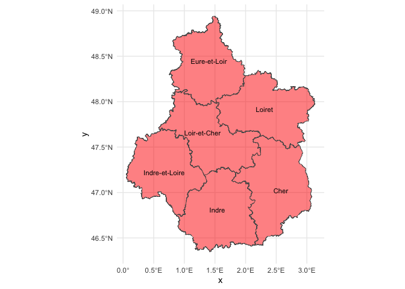
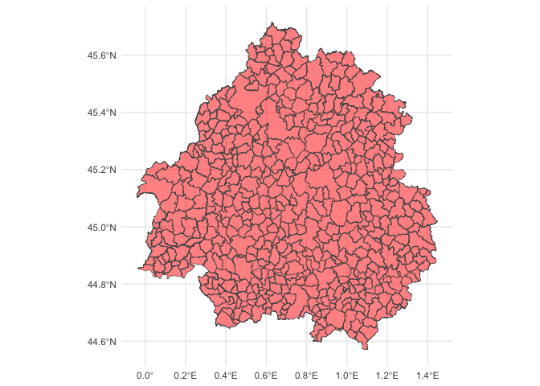

<!-- README.md is generated from README.Rmd. Please edit that file -->

# insee.admin

<!-- badges: start -->

<!-- badges: end -->

The goal of `insee.admin` is to provide functions to prepare French
administrative boundaries: linking hierarchical levels together and
preparing `sf` files for each level.

## Installation

You can install the development version of `insee.admin` like so:

``` r
remotes::install_github("AcidyBee/insee.admin")
```

## Example

This is a basic example which shows you how to prepare spatial data at
various administrative granularities.

``` r
sf_COM <- pipeline_sf_admin_express_cog(path_to_extdata, layer = "COMMUNE")
#> Reading layer `COMMUNE' from data source 
#>   `/private/var/folders/nc/5vts19dd3hnd7nybsl3bz80m0000gn/T/Rtmp8a5KT8/temp_libpathe57f98b532d/insee.admin/extdata' 
#>   using driver `ESRI Shapefile'
#> Simple feature collection with 503 features and 11 fields
#> Geometry type: MULTIPOLYGON
#> Dimension:     XY
#> Bounding box:  xmin: -0.04189031 ymin: 44.57073 xmax: 1.448239 ymax: 45.71476
#> Geodetic CRS:  WGS 84
sf_DEP <- pipeline_sf_admin_express_cog(path_to_extdata, layer = "DEPARTEMENT")
#> Reading layer `DEPARTEMENT' from data source 
#>   `/private/var/folders/nc/5vts19dd3hnd7nybsl3bz80m0000gn/T/Rtmp8a5KT8/temp_libpathe57f98b532d/insee.admin/extdata' 
#>   using driver `ESRI Shapefile'
#> Simple feature collection with 6 features and 5 fields
#> Geometry type: POLYGON
#> Dimension:     XY
#> Bounding box:  xmin: 0.05273884 ymin: 46.3469 xmax: 3.128678 ymax: 48.94103
#> Geodetic CRS:  WGS 84
```

### Spatial data

Maps of Centre-Val de Loire region at various administrative
granularities:

- DEPARTEMENT:

``` r
sf_DEP %>%
  ggplot2::ggplot() +
  ggplot2::geom_sf(fill = "red", alpha = .5) +
  ggplot2::geom_sf_text(ggplot2::aes(label = dep_lib), size = 3) +
  ggplot2::coord_sf() +
  ggplot2::theme_minimal()
#> Warning in st_point_on_surface.sfc(sf::st_zm(x)): st_point_on_surface may not
#> give correct results for longitude/latitude data
```



- COMMUNE:

``` r
sf_COM %>%
  ggplot2::ggplot() +
  ggplot2::geom_sf(fill = "red", alpha = .5) +
  ggplot2::coord_sf() +
  ggplot2::theme_minimal()
```


